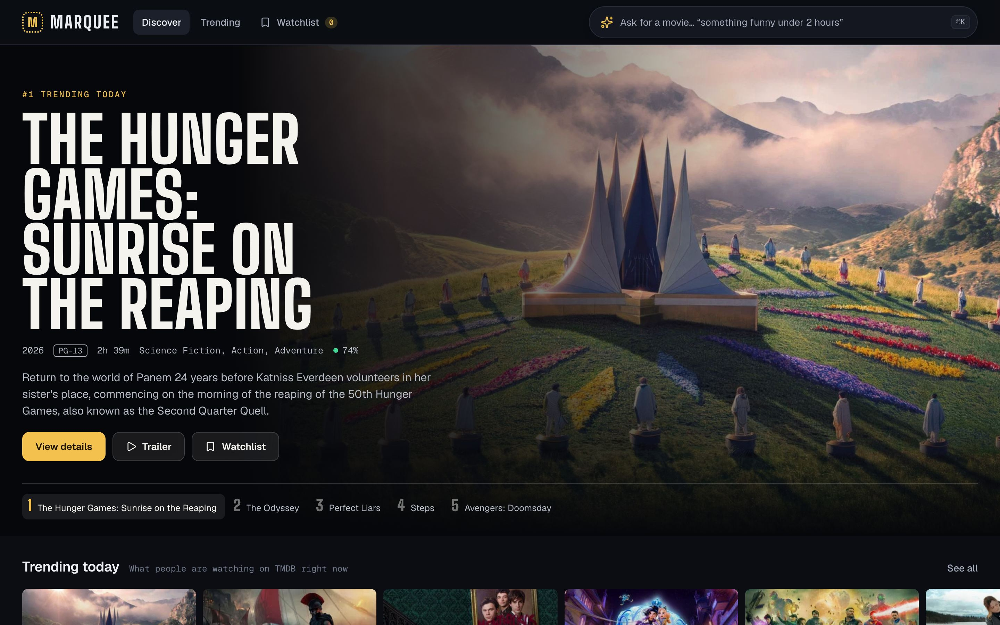
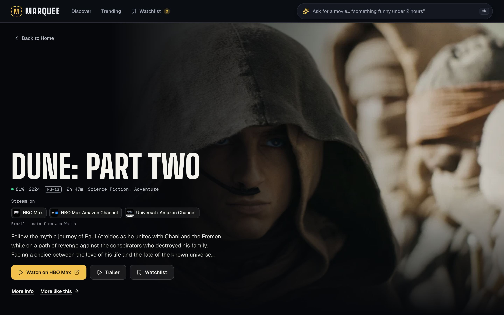
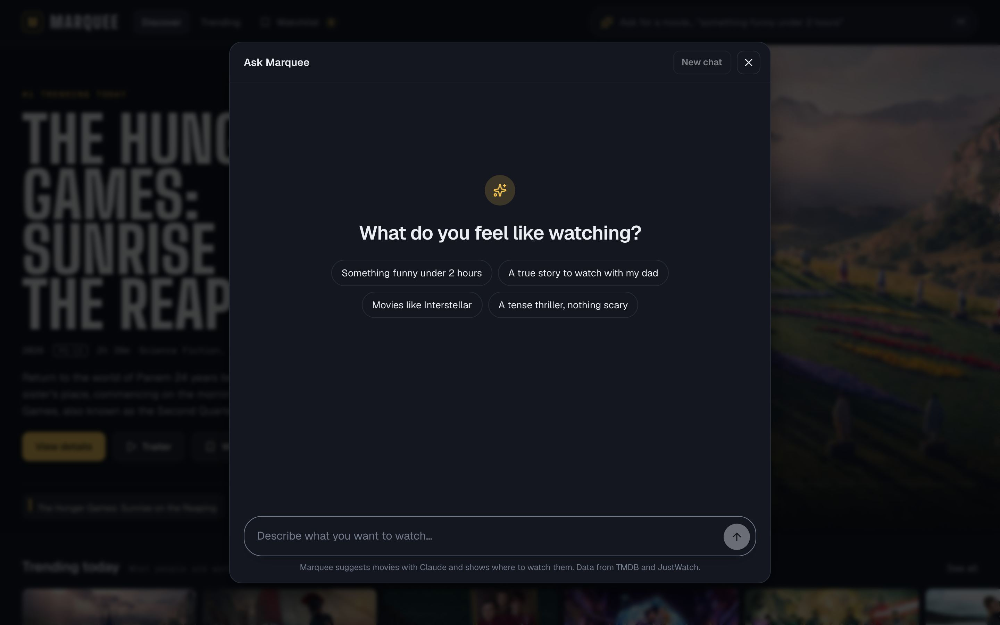
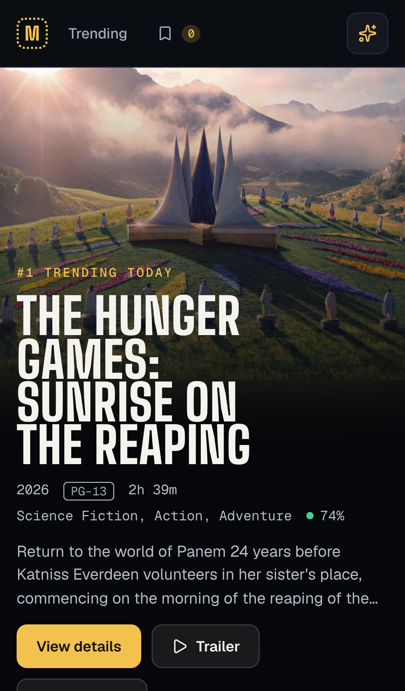
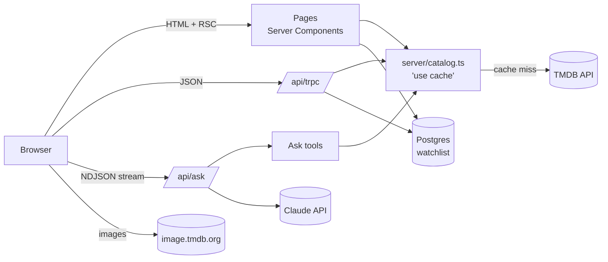

# Marquee

A movie discovery site on the [TMDB API](https://developer.themoviedb.org/). The home page shows
what the world is watching today; every movie has its own page with where to stream it in your
country; a watchlist remembers what you save; and **Ask Marquee** finds a movie from a description
such as "something funny under 2 hours".

Built as the Ordinal take-home. **Live:** https://marquee-khaki.vercel.app



<p>
  
  
</p>
<p align="center">
  
</p>

## Quick start

Requirements: Node 22.12+ (24 recommended), pnpm (`corepack enable`), and optionally Docker.

```bash
pnpm install
pnpm dev
```

`pnpm dev` takes a fresh clone to a running app at http://localhost:3000:

- It creates `.env` from `.env.example` when there is none.
- Without a TMDB token it serves a recorded catalog of 26 movies, so it runs with no keys at all.
- With Docker running it starts Postgres, applies the migrations and turns the watchlist on.
  Without Docker the watchlist is off and everything else works.
- It prints which of those it chose, then starts the Next.js dev server.

Add keys to `.env` to light up the rest:

| Variable | Turns on | Without it |
| --- | --- | --- |
| `TMDB_READ_TOKEN` | Live TMDB data ([get a token](https://www.themoviedb.org/settings/api)) | The recorded catalog. |
| `ANTHROPIC_API_KEY` | Ask Marquee answering with Claude | The chat answers with a title search. |
| `DATABASE_URL` | The watchlist (preset to the Docker Postgres) | No watchlist. |
| `NEXT_PUBLIC_SITE_URL` | Absolute URLs in share cards | Vercel's URL, then localhost. |

## What to look at

| Feature | Where | Why it is interesting |
| --- | --- | --- |
| Partial prerendering | `apps/web/src/app/**/page.tsx` | Pages ship a cached static shell; only country- and cookie-dependent parts stream in. |
| One cache for every reader | `apps/web/src/server/catalog.ts` | `'use cache'` functions serve Server Components, tRPC and the chat's tools alike. |
| Prefetch on intent + shared-element morph | `apps/web/src/components/movie/movie-link.tsx` | Partial Prefetching plus `prefetch={true}` after hover; React 19.3 `<ViewTransition>` morphs the tile into the backdrop. |
| Blur-up images | `apps/web/src/server/placeholders.ts`, `components/movie/tmdb-image.tsx` | A 16px preview of every image is inlined in the HTML, so it paints before any JavaScript; the full image fades in once loaded. |
| Optimistic watchlist | `apps/web/src/components/watchlist/` | Saves update the button, header count, My List and the watchlist page from one cache entry before the server answers; the server seeds that cache with the page. |
| Trailer warm-up | `apps/web/src/components/movie/trailer-dialog.tsx` | Hover or focus preconnects to YouTube and boots the player hidden, so it plays almost at once on click. |
| Ask Marquee | `apps/web/src/server/ask/`, `apps/web/src/ask/` | Claude tool use over the cached catalog, streamed as NDJSON; picks are limited to ids the tools returned. |
| Instant navigation tests | `apps/web/e2e/instant.spec.ts` | `instant()` from `@next/playwright` fails CI if a page stops rendering from its shell. |
| Typed TMDB client | `packages/tmdb` | zod-validated responses, normalized types, retry on rate limits, and a fixture `fetch` for tests. |

## Stack

Next.js 16.4 (App Router, Cache Components, Partial Prefetching, React Compiler, typed routes,
Turbopack) · React 19.3 · TypeScript 7 · Tailwind CSS 4 · shadcn/Radix · tRPC 11 + TanStack Query ·
Prisma 7 + Postgres · Anthropic SDK (Claude Opus 5.5) · Turborepo + pnpm · Vitest · Playwright ·
oxlint/oxfmt.

## Architecture



```
apps/web            Next.js app, the only deployable
  src/app           routes, share images, error and not-found pages
  src/components    UI by feature: home, movie, trending, watchlist, layout, ui
  src/ask           chat client: provider, panel, stream hook, event protocol
  src/server        server-only: catalog, placeholders, region, viewer cookie, database, ask agent
  src/trpc          tRPC + TanStack Query client
  e2e               Playwright smoke and instant-navigation tests
packages/tmdb       TMDB client, zod schemas, normalized types, fixture catalog
packages/api        tRPC routers, Catalog interface, discover filter schema
packages/db         Prisma schema, migrations, watchlist queries
tooling/typescript  shared tsconfig presets
scripts/dev.mjs     the one-command local setup
```

Dependencies point one way: the app imports the packages, `api` imports `tmdb`, and no package
imports Next.js. That keeps every package testable in plain Node.

### Key decisions

- **Server Components read cached functions directly; tRPC only serves the browser.** An API layer
  adds a hop when the caller already runs on the server, and the direct call is what lets Next.js
  prerender cached data into the static shell. tRPC routers reach the same functions through a
  `Catalog` interface, so both share one cache.
- **Partial prerendering instead of per-request rendering.** Almost every byte of a page is the same
  for everyone; only "where to watch" (country, from Vercel's geo header) and the personal rows
  (cookie) wait for the request.
- **Prefetch on intent.** The home page has over a hundred movie links. Partial Prefetching loads
  one shell per route, and a movie link asks for its own content only after hover or focus.
- **tRPC mutation for the watchlist, not a Server Action.** Saved state cannot live in HTML that is
  cached for everyone, so it is a client query every save button reads. The mutation sets the state
  explicitly (`set({ movieId, saved })`), so double clicks and Undo are safe to repeat.
- **Anonymous cookie created by the first save.** No accounts, and visitors who never save never
  carry a cookie, so nothing personal touches cached pages.
- **Images straight from TMDB's CDN, with inline previews.** A custom `next/image` loader picks the
  nearest size TMDB already serves; row tiles use the 300px backdrop. Previews are tiny WebPs made
  with sharp and cached per image, inlined so they paint before JavaScript. A CSS `blur()` on them
  cost over a second of main-thread time on a throttled phone, so the browser's own upscaling does
  the softening.
- **Soft 404 for unknown movies.** The shell is already streaming when the lookup fails, so the
  not-found page arrives with status 200 and Next.js marks it `noindex`.
- **Fixtures at the `fetch` layer.** Tests, CI and keyless local runs go through the real URL
  building, parsing and normalization against 26 recorded movies.

## Performance

Lighthouse 13.6 on the live site, mobile profile (simulated slow 4G and a 4× slower CPU), median of
several runs:

| Page | Performance | Largest Contentful Paint | Total Blocking Time | Layout shift |
| --- | --- | --- | --- | --- |
| Home | 81 | 4.8 s | 140 ms | 0 |
| Movie | 90 | 3.6 s | 10 ms | 0 |
| Trending | 86 | 4.1 s | 60 ms | 0 |

Accessibility, best practices and SEO score 96–100. Two notes:

- The largest paint is the hero backdrop, about 96 KB from TMDB's CDN, so the simulated slow
  connection dominates it. A local production build scores 99 on the home page, with LCP at 1.5 s.
- A cold first run sometimes shows a single 2-second main-thread task that Lighthouse cannot
  attribute to any script; repeat runs don't.

## Tests

```bash
pnpm test         # Vitest: tmdb client, tRPC routers, Postgres queries, chat protocol and tools
pnpm test:e2e     # Playwright against a production build on fixtures
pnpm lint && pnpm fmt:check && pnpm typecheck
```

The database tests use `DATABASE_URL`, so run `pnpm dev` (or `pnpm db:up`) first. CI runs all of
it on each push, with a Postgres service container, and restores `.next/cache` so Turbopack's build
cache carries over between runs.

## Deploying

Vercel project rooted at `apps/web`, connected to this repository, with `TMDB_READ_TOKEN`,
`DATABASE_URL` (Prisma Postgres from the Vercel marketplace) and `ANTHROPIC_API_KEY`.
`apps/web/vercel.json` generates the Prisma client and applies migrations before each build.

## Known limitations

- **Ask Marquee needs Anthropic credits.** Without them, or without a key, it answers with a title
  search and says so.
- **The chat's rate limit lives in server memory** (8 requests a minute and 60 a day per IP). Each
  warm serverless instance counts separately; a real limit needs a shared store.
- **The watchlist belongs to one browser.** It is tied to an anonymous cookie, with no accounts or
  sync.
- **"Because you saved" updates on the next visit,** not the moment you save, so the page never
  jumps under you.
- **Unknown movie ids return status 200** with the not-found page (marked `noindex`), because the
  page shell has already streamed.
- **Where to watch follows the visitor's country** from Vercel's geo header or the browser language;
  there is no country picker.
- **Row tiles use TMDB's 300px backdrop,** slightly soft on high-density screens, in exchange for a
  third of the bytes.
- **English only.**

## Scope and time

The brief suggests 1–2 hours for a trending page and a detail view. That core is small, and it
stands on its own here. I used the rest as a chance to show how I would ship a production version
of it: a caching and rendering strategy, an optimistic watchlist, an AI-assisted way to search,
image loading tuned for slow connections, and tests and CI that keep it honest.

## Next steps

- **Accounts** (Auth.js or Clerk) to sync the watchlist across devices, merging the anonymous list on
  sign-in.
- **Inngest jobs** to refresh the trending cache right after TMDB recomputes it
  (`revalidateTag('trending')`) and to warm popular movie pages, instead of time-based expiry.
- **A shared rate limit and spending cap for Ask Marquee** (for example Upstash Redis), plus
  conversation memory per viewer.
- **Evals for Ask Marquee:** a fixed set of requests with expected picks, run in CI against recorded
  responses, so prompt or model changes can't quietly make answers worse.
- **Trending page in the static shell:** move the window choice into the path, so the first posters
  ship with the shell.
- **A lighter hero on phones:** TMDB's backdrops jump from 300 to 780px wide, so phones download the
  780px file for the hero; a smaller crop would cut the largest paint on slow connections.
- **A country and language picker,** with localized TMDB data (pt-BR first).
- **Observability:** Sentry and OpenTelemetry traces for TMDB and Claude calls, next to the Speed
  Insights already in place.
- **Performance and accessibility budgets in CI:** Lighthouse CI and axe checks in Playwright, so
  the numbers above can't regress unnoticed.

## Attribution

This website uses TMDB and the TMDB APIs but is not endorsed, certified, or otherwise approved by
TMDB. Streaming availability data is provided by JustWatch. The app shows TMDB's approved logo and
this notice at the foot of the home page and in each movie's More info dialog.
