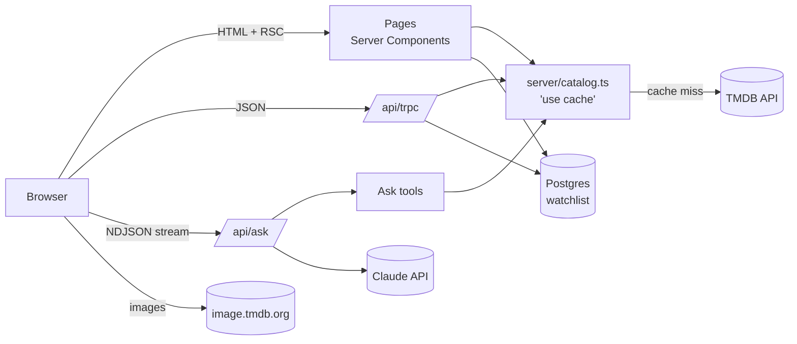

# Marquee

A movie discovery site on the [TMDB API](https://developer.themoviedb.org/). The home page shows
what the world is watching today; every movie has its own page with where to stream it in your
country; a watchlist remembers what you save; and **Ask Marquee** finds a movie from a description
such as "something funny under 2 hours".

Built as the Ordinal take-home.

## What to look at

| Feature | Where | Why it is interesting |
| --- | --- | --- |
| Partial prerendering | `apps/web/src/app/**/page.tsx` | Pages ship a cached static shell; only country- and cookie-dependent parts stream in. |
| One cache for every reader | `apps/web/src/server/catalog.ts` | `'use cache'` functions serve Server Components, tRPC and the chat's tools alike. |
| Prefetch on intent + shared-element morph | `apps/web/src/components/movie/movie-link.tsx` | Partial Prefetching plus `prefetch={true}` after hover; React 19.3 `<ViewTransition>` morphs the tile into the backdrop. |
| Instant navigation tests | `apps/web/e2e/instant.spec.ts` | `instant()` from `@next/playwright` fails CI if a page stops rendering from its shell. |
| Ask Marquee | `apps/web/src/server/ask/`, `apps/web/src/ask/` | Claude tool use over the cached catalog, streamed as NDJSON; picks are limited to ids the tools returned. |
| Typed TMDB client | `packages/tmdb` | zod-validated responses, normalized types, retry on rate limits, and a fixture `fetch` for tests. |
| Optimistic watchlist | `apps/web/src/components/watchlist/` | tRPC mutation with rollback; an anonymous cookie created by the first save. |

## Stack

Next.js 16.4 (App Router, Cache Components, Partial Prefetching, React Compiler, typed routes,
Turbopack) · React 19.3 · TypeScript 7 · Tailwind CSS 4 · tRPC 11 + TanStack Query · Prisma 7 +
Postgres · Anthropic SDK (Claude Opus 5.5) · Turborepo + pnpm · Vitest · Playwright · oxlint/oxfmt.

## Architecture



```
apps/web            Next.js app, the only deployable
  src/app           routes, share images, error and not-found pages
  src/components    UI by feature: home, movie, trending, watchlist, layout, ui
  src/ask           chat client: provider, panel, stream hook, event protocol
  src/server        server-only: catalog, region, viewer cookie, database, ask agent
  src/trpc          tRPC + TanStack Query client
  e2e               Playwright smoke and instant-navigation tests
packages/tmdb       TMDB client, zod schemas, normalized types, fixture catalog
packages/api        tRPC routers, Catalog interface, discover filter schema
packages/db         Prisma schema, migrations, watchlist queries
tooling/typescript  shared tsconfig presets
```

Dependencies point one way: the app imports the packages, `api` imports `tmdb`, and no package
imports Next.js. That keeps every package testable in plain Node.

### Key decisions

- **Server Components read cached functions directly; tRPC only serves the browser.** An API layer
  adds a hop when the caller already runs on the server, and the direct call is what lets Next.js
  prerender cached data into the static shell. tRPC routers reach the same functions through a
  `Catalog` interface, so both share one cache.
- **Partial prerendering instead of per-request rendering.** Almost every byte of a page is the same
  for everyone; only "where to watch" (country, from Vercel's geo header) and the personal rows
  (cookie) wait for the request.
- **Prefetch on intent.** The home page has over a hundred movie links. Partial Prefetching loads
  one shell per route, and a movie link asks for its own content only after hover or focus.
- **tRPC mutation for the watchlist, not a Server Action.** Saved state cannot live in HTML that is
  cached for everyone, so it is a client query every save button reads, with an optimistic update.
- **Anonymous cookie created by the first save.** No accounts, and visitors who never save never
  carry a cookie, so nothing personal touches cached pages.
- **Images straight from TMDB's CDN.** A custom `next/image` loader picks the nearest size TMDB
  already serves instead of re-optimizing every poster.
- **Soft 404 for unknown movies.** The shell is already streaming when the lookup fails, so the
  not-found page arrives with status 200 and Next.js marks it `noindex`.
- **Fixtures at the `fetch` layer.** Tests and CI run the real URL building, parsing and
  normalization against 26 recorded movies, with no TMDB token.

## Running locally

Requirements: Node 22.12+ (24 recommended), pnpm 11 (`corepack enable`), Docker.

```bash
pnpm install
cp .env.example .env        # then fill in what you have; see below
pnpm db:up                  # local Postgres on port 54339
pnpm db:migrate
pnpm dev                    # http://localhost:3000
```

| Variable | Needed for | Without it |
| --- | --- | --- |
| `TMDB_READ_TOKEN` | Real TMDB data ([get one](https://www.themoviedb.org/settings/api)) | Set `TMDB_FIXTURES=1` to run on recorded data. |
| `DATABASE_URL` | The watchlist | The watchlist is hidden; everything else works. |
| `ANTHROPIC_API_KEY` | Ask Marquee with Claude | The chat answers with a title search instead. |
| `NEXT_PUBLIC_SITE_URL` | Absolute URLs in share cards | Falls back to Vercel's URL, then localhost. |

## Tests

```bash
pnpm test         # Vitest: tmdb client, tRPC routers, Postgres queries, chat protocol and tools
pnpm test:e2e     # Playwright against a production build on fixtures
pnpm lint && pnpm fmt:check && pnpm typecheck
```

The database tests use `DATABASE_URL`, so start Postgres first. CI runs everything on each push,
with a Postgres service container, and restores `.next/cache` so Turbopack's build cache carries
over between runs.

## Deploying

Vercel project rooted at `apps/web`, with `TMDB_READ_TOKEN`, `DATABASE_URL` (Prisma Postgres from
the Vercel marketplace) and `ANTHROPIC_API_KEY`. Run `pnpm -C packages/db db:deploy` before each
build to apply migrations.

## Attribution

This website uses TMDB and the TMDB APIs but is not endorsed, certified, or otherwise approved by
TMDB. Streaming availability data is provided by JustWatch. The app shows TMDB's approved logo and
this notice at the foot of the home page and in each movie's More info dialog.
